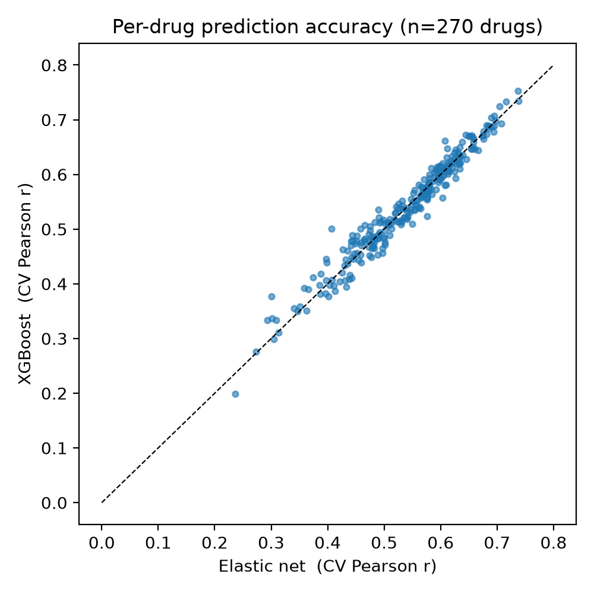
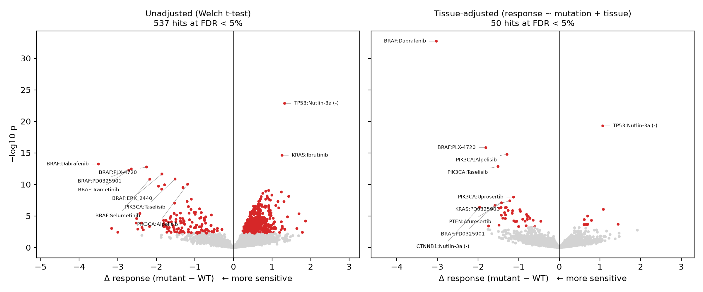
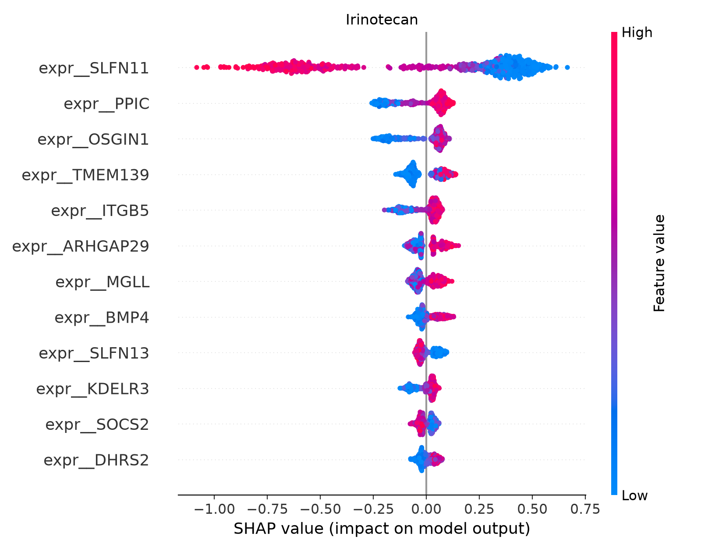
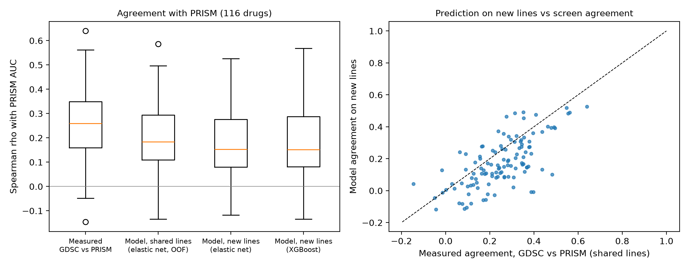

# Pharmacogenomic Drug Response Modeling (GDSC2 × DepMap)

Predict cancer cell line drug sensitivity from transcriptomic and mutation
features, and find response biomarkers. Uses only public data.

**Questions**
1. Which hotspot mutations make cell lines significantly more sensitive or
   resistant to a drug? (GDSC-style association scan with FDR control.)
2. How well can drug response (LN IC50) be predicted from expression and
   mutation data? How does a sparse linear model (elastic net) compare with
   gradient boosting (XGBoost)?
3. Which features drive the predictions? (SHAP attribution, with known
   biomarkers used as positive controls.)
4. Do the models and biomarkers hold up in an independent screen that used a
   different assay and includes cell lines never screened in GDSC? (External
   validation in PRISM Repurposing.)

## Data
| Source | File | What it gives |
|---|---|---|
| GDSC release 8.5 (Sanger) | `GDSC2_fitted_dose_response.xlsx` | LN IC50 / AUC for ~280 drugs × ~970 lines |
| DepMap 24Q4 Public (Broad) | `Model.csv` | maps Sanger IDs (SIDM…) to DepMap IDs (ACH-…) |
| DepMap 24Q4 Public | `OmicsExpressionProteinCodingGenesTPMLogp1.csv` | log2(TPM+1) RNA-seq |
| DepMap 24Q4 Public | `OmicsSomaticMutationsMatrixHotspot.csv` | hotspot mutation calls per gene |
| PRISM Repurposing 20Q2 (Broad) | `prism-repurposing-20q2-secondary-screen-dose-response-curve-parameters.csv` | dose-response AUC, used only for external validation |

```bash
bash scripts/00_download.sh      # ~820 MB; GDSC from Sanger, DepMap and PRISM from figshare (MD5-checked)
```

DepMap, Broad (2024). DepMap 24Q4 Public. figshare+. Dataset.
https://doi.org/10.25452/figshare.plus.27993248

PRISM Repurposing 20Q2 secondary screen (Corsello et al., 2020). figshare.
https://doi.org/10.6084/m9.figshare.20564034.v1

## Run
```bash
conda env create -f environment.yml && conda activate drugresp
./run_all.sh --test              # 1-minute smoke test on synthetic data
./run_all.sh                     # real data (2 h 49 min for 270 drugs on a MacBook Air, Apple Silicon)
```
For a fast first pass, set `modeling.max_drugs: 20` in `config/config.yaml`.
On SCINet, wrap `run_all.sh` in an `sbatch` script with `--cpus-per-task=16`.

## Method
* **Features:** the top 2,000 most variable genes plus every annotated drug
  target gene, and binary hotspot mutation status for genes mutated in at
  least 10 lines. Variance filtering is unsupervised, so it doesn't leak the
  response into feature selection.
* **Associations:** for every drug × gene pair with at least 10 mutant and 10
  wild-type lines, the primary test is a tissue-adjusted linear model,
  `response ~ mutation + tissue` (DepMap OncotreeLineage; lineages with fewer
  than 10 screened lines pooled as "Other"), testing the mutation coefficient.
  An unadjusted Welch t-test is kept for comparison. Benjamini-Hochberg FDR is
  applied to each. A negative Δ means the mutant lines are more sensitive.
  Duplicate screens of a drug are averaged per cell line.
* **Prediction:** 5-fold outer CV with out-of-fold predictions. Elastic net
  tunes α (15 values from α_max down to α_max/100) and l1_ratio (0.1, 0.5,
  0.9) by inner 3-fold CV on each training fold, and scaling
  is fit inside each fold. Metrics are Pearson r, Spearman ρ and RMSE.
* **Explanation:** TreeExplainer SHAP on XGBoost refit to the full data for
  the best-predicted drugs. Lapatinib is also explained as an expression
  control: its biomarker is ERBB2 amplification, which shows up as high ERBB2
  expression rather than as a hotspot mutation.
* **External validation (PRISM):** drugs are matched to GDSC by normalized
  name. The PRISM response is dose-response AUC (lower = more sensitive),
  taking the MTS010 screen where a pair was measured more than once, as the
  PRISM documentation recommends, and keeping only cell lines that passed STR
  profiling. Agreement is Spearman ρ, since GDSC LN IC50 and PRISM AUC are on
  different scales. Three comparisons per drug: (1) measured GDSC vs measured
  PRISM response on shared cell lines, the ceiling any model can reach;
  (2) GDSC out-of-fold predictions vs PRISM on shared lines; (3) models
  trained on all GDSC lines predicting PRISM lines never screened in GDSC,
  with features built from DepMap in the same way. Each tissue-adjusted GDSC
  association for a matched drug is re-tested in PRISM with the same model;
  GDSC associations that were not significant are re-tested as a baseline.

## Outputs (`results/`)
Figures and the small summary tables are committed; the full association
table and intermediate files are regenerated by `./run_all.sh`.

| File | Content |
|---|---|
| `associations/mutation_drug_associations.csv` | all drug × mutation tests (unadjusted `p`/`fdr`, tissue-adjusted `p_adj`/`fdr_adj`) |
| `associations/positive_controls.csv` | e.g. BRAF→Dabrafenib, TP53→Nutlin-3a (resistance) |
| `models/expression_controls.csv` | SHAP rank of ERBB2 expression in the Lapatinib model |
| `models/cv_metrics.csv`, `cv_summary.csv` | per-drug and median CV performance |
| `models/xgboost_r_by_pathway.csv` | predictability by target pathway |
| `models/shap_top_features.csv` | top SHAP features per drug |
| `prism/drug_validation.csv` | per-drug agreement with PRISM (measured, shared lines, new lines) |
| `prism/association_replication.csv` | GDSC associations re-tested in PRISM |
| `figures/fig1-4*.png` | model comparison, volcano plots (unadjusted vs tissue-adjusted), SHAP summaries, PRISM validation |

## Results
GDSC2 (release 8.5) × DepMap 24Q4. 967 of 969 GDSC2 cell lines map to a
DepMap ID; 713 also have RNA-seq and hotspot mutation calls. Features: 2,112
expression genes (2,000 most variable + 112 drug targets) and 21 hotspot genes.

**Prediction.** 270 drugs had ≥ 300 screened lines (411-713 per drug, median 659).

| Model | Median CV Pearson r (IQR) | Median Spearman ρ |
|---|---|---|
| Elastic net | 0.554 (0.477-0.607) | 0.531 |
| XGBoost | 0.546 (0.479-0.610) | 0.529 |

- The two models are statistically indistinguishable: XGBoost is better on
  132 of 270 drugs (Wilcoxon signed-rank p = 0.56). Gradient boosting adds
  nothing over a sparse linear model here (fig1).

  

- 184 of 270 drugs reach r > 0.5. Best predicted: Nutlin-3a (0.75), AZD5991
  (MCL1, 0.73), Venetoclax (BCL2, 0.72), Irinotecan (TOP1, 0.70).
- By target pathway (XGBoost median r): p53 pathway 0.66, DNA replication 0.64
  and cell cycle 0.61 are most predictable; PI3K/MTOR (0.48) and WNT (0.45)
  are least.

**Associations.** 4,683 drug × mutation tests.

| | FDR < 5% hits | sensitizing | resistance |
|---|---|---|---|
| Unadjusted t-test | 537 | 131 | 406 |
| Tissue-adjusted | **50** | **40** | **10** |



- Without adjustment, tissue of origin dominates. 70 sensitizing hits were
  EZH2, whose 10 mutant lines are 80% lymphoid (lymphoma lines respond to
  many drugs), and 214 hits were KRAS, whose mutant lines are 75% lung,
  pancreas and bowel. After adjustment: EZH2 70 → 0, KRAS 214 → 12.
- The 40 adjusted sensitizing hits are mostly known pathway biology:
  - BRAF (13 hits): 12 are BRAF, MEK or ERK inhibitors (e.g. Dabrafenib,
    Trametinib, Ulixertinib).
  - PIK3CA (10): 4 PI3K inhibitors (Alpelisib, Taselisib, Pictilisib,
    Buparlisib) and 6 AKT inhibitors.
  - PTEN (6): 5 AKT inhibitors (Afuresertib, AZD5363, Ipatasertib,
    Uprosertib, GSK2110183B).
  - NRAS (5) and KRAS (4): MEK/ERK inhibitors only.
- KRAS mutation predicts resistance to EGFR/HER2 and other RTK inhibitors
  (Osimertinib, Lapatinib, Afatinib, Cediranib, Axitinib, Foretinib),
  consistent with KRAS signaling downstream of the receptor.
- Positive controls (tissue-adjusted): BRAF → Dabrafenib Δ = −3.03, FDR 9e-30;
  BRAF → Trametinib Δ = −1.39, FDR 0.004; BRAF → SB590885 Δ = −0.97,
  FDR 3e-4; TP53 → Nutlin-3a *resistance* Δ = +1.07, FDR 1e-16 (MDM2
  inhibition needs functional p53). EGFR → Erlotinib was not testable (8
  mutant lines).

**SHAP.** Top features recover known biomarkers:
- Irinotecan: SLFN11 expression, by a wide margin (mean |SHAP| 0.44 vs 0.10
  for the next feature), the established TOP1-inhibitor sensitivity marker.
  High SLFN11 lowers the predicted IC50 (more sensitive), the published
  direction.
- Venetoclax: expression of its target BCL2 ranks first.
- Nutlin-3a: MDM2 expression, TP53 mutation and CDKN2A expression are the top 3.
- Lapatinib (expression control): ERBB2 expression ranks 5th of 2,133
  features (XGBoost r = 0.54).



SHAP summaries for all explained drugs are in [`results/figures/`](results/figures/).

## External validation in PRISM
116 drugs were screened in both GDSC and PRISM. They share a median of 325
cell lines per drug, and PRISM adds 236 cell lines that were never screened
in GDSC (median 133 per drug) with DepMap expression and mutation data.

| Agreement with PRISM AUC, median Spearman ρ over 116 drugs | ρ |
|---|---|
| Measured GDSC response vs measured PRISM response (shared lines) | 0.26 (IQR 0.16-0.35) |
| GDSC elastic net, out-of-fold predictions (shared lines) | 0.18 |
| GDSC elastic net trained on all lines, **new lines** | 0.15 (IQR 0.08-0.28) |
| GDSC XGBoost trained on all lines, **new lines** | 0.15 |

- **The two screens agree only modestly** on the same drug and cell line
  (median ρ 0.26; below 0.2 for 41 of 116 drugs), consistent with the
  known discordance between large pharmacogenomic screens (Haibe-Kains et
  al., 2013).
- **The models transfer, within that ceiling.** On cell lines never seen in
  training and measured with a different assay, predictions correlate
  significantly and positively with PRISM for 62 of 116 drugs. For drugs
  where the screens agree at least moderately (ρ ≥ 0.2), the model reaches a
  median 71% of the measured agreement. Elastic net and XGBoost again perform
  the same (Wilcoxon p = 0.29).
- **Within-GDSC accuracy does not predict transfer.** Across drugs, new-line
  agreement tracks how well the two screens agree (Spearman 0.65,
  p = 3e-15), not GDSC cross-validation accuracy (Spearman 0.13, p = 0.18,
  109 drugs). Cytarabine, lenalidomide, I-BET-762 and BMS-345541 reach GDSC
  CV r of 0.56-0.68 but show no agreement with PRISM, and their measured
  screen agreement is also near zero. Cross-validation within one screen
  therefore overstates how well a model will generalize to another.
- Best transfer on new lines: PD0325901 (MEK, ρ 0.53), dasatinib (0.52),
  SN-38 (0.49), topotecan (0.49), trametinib (0.48).

**Biomarker replication.** 30 of the 50 tissue-adjusted GDSC associations
could be tested in PRISM (the rest involve drugs not in PRISM or fewer than
10 mutant lines).

| GDSC association | Testable in PRISM | Same direction | Replicated (same direction, p < 0.05) |
|---|---|---|---|
| Significant (FDR < 5%) | 30 | 87% | **53% (16)** |
| Not significant (baseline) | 1,605 | 54% | 5% |

- Significant GDSC associations replicate about ten times more often than the
  chance baseline. Replicated: BRAF with dabrafenib, SB590885 and trametinib;
  PIK3CA with alpelisib, taselisib and uprosertib; KRAS and NRAS with the MEK
  inhibitors trametinib, PD0325901, selumetinib and refametinib; and KRAS
  with resistance to osimertinib and ibrutinib.
- Not replicated: KRAS with resistance to afatinib, lapatinib and three
  multi-kinase inhibitors, and PTEN with sensitivity to AKT inhibitors.



## Related work
This project is an independent reanalysis on current data releases (GDSC2
release 8.5, DepMap 24Q4). The main analyses follow established work, and the
recovered biomarkers are known findings, which is why they serve as controls.

- **Mutation-drug association scan.** Garnett et al. (2012) introduced the
  GDSC screen and the systematic association of cancer gene mutations with
  drug response. Iorio et al. (2016) extended it to 265 drugs and 1,001 cell
  lines and highlighted the role of tissue lineage in drug response, which
  motivates the tissue-adjusted test used here.
- **Drug response prediction.** Barretina et al. (2012) built elastic net
  predictors of drug sensitivity on the CCLE. Jang et al. (2014) compared over
  110,000 models and recommended elastic net or ridge regression with gene
  expression features. The finding here that XGBoost does not outperform
  elastic net is consistent with that recommendation. In the NCI-DREAM
  challenge (Costello et al., 2014), on breast cancer lines with multiple data
  types, the top methods modeled nonlinear relationships and pathway
  information; this project does neither, so it does not test that result.
- **SLFN11.** Expression of SLFN11 predicts sensitivity to topoisomerase I
  inhibitors (Zoppoli et al., 2012; Barretina et al., 2012), the top SHAP
  feature for irinotecan here.
- **Agreement between screens.** Haibe-Kains et al. (2013) showed that drug
  response measured in two large pharmacogenomic screens is highly
  discordant even when the genomic data agree. The PRISM validation here
  quantifies the same issue for GDSC2 and PRISM (Corsello et al., 2020) and
  shows how it bounds the transfer of trained models.

### References
1. Garnett MJ, et al. Systematic identification of genomic markers of drug
   sensitivity in cancer cells. *Nature* 483:570-575 (2012).
   [doi:10.1038/nature11005](https://doi.org/10.1038/nature11005)
2. Barretina J, et al. The Cancer Cell Line Encyclopedia enables predictive
   modelling of anticancer drug sensitivity. *Nature* 483:603-607 (2012).
   [doi:10.1038/nature11003](https://doi.org/10.1038/nature11003)
3. Zoppoli G, et al. Putative DNA/RNA helicase Schlafen-11 (SLFN11) sensitizes
   cancer cells to DNA-damaging agents. *PNAS* 109:15030-15035 (2012).
   [doi:10.1073/pnas.1205943109](https://doi.org/10.1073/pnas.1205943109)
4. Jang IS, et al. Systematic assessment of analytical methods for drug
   sensitivity prediction from cancer cell line data. *Pac Symp Biocomput*
   2014:63-74. [PMID 24297534](https://pubmed.ncbi.nlm.nih.gov/24297534/)
5. Costello JC, et al. A community effort to assess and improve drug
   sensitivity prediction algorithms. *Nat Biotechnol* 32:1202-1212 (2014).
   [doi:10.1038/nbt.2877](https://doi.org/10.1038/nbt.2877)
6. Iorio F, et al. A landscape of pharmacogenomic interactions in cancer.
   *Cell* 166:740-754 (2016).
   [doi:10.1016/j.cell.2016.06.017](https://doi.org/10.1016/j.cell.2016.06.017)
7. Haibe-Kains B, et al. Inconsistency in large pharmacogenomic studies.
   *Nature* 504:389-393 (2013).
   [doi:10.1038/nature12831](https://doi.org/10.1038/nature12831)
8. Corsello SM, et al. Discovering the anti-cancer potential of non-oncology
   drugs by systematic viability profiling. *Nat Cancer* 1:235-248 (2020).
   [doi:10.1038/s43018-019-0018-6](https://doi.org/10.1038/s43018-019-0018-6)

## Limitations / next steps
- Cell lines are an imperfect stand-in for patient tumors. Tissue adjustment
  removes between-lineage confounding but not confounders within a lineage
  (e.g. subtype).
- A few adjusted hits have no obvious mechanism (e.g. CTNNB1 → Nutlin-3a
  sensitivity, 16 mutant lines) and would need independent validation.
- SHAP is computed on models refit to all lines, so it explains what the model
  uses, not held-out performance.
- In profiling, elastic net picked l1_ratio = 0.1 (the most ridge-like value
  in the grid) for 2 of 3 drugs tested. Selected hyperparameters aren't saved
  per drug yet; saving them and widening the grid is a possible refinement.
- PRISM and GDSC report different response metrics (AUC vs LN IC50), source
  compounds separately, and use different assays, so the PRISM comparison
  measures agreement in ranking, not in absolute values. Drugs are matched by
  name only; drugs listed under different names in the two screens are
  missed.
- Possible extension: connectivity-map (LINC L1000) scoring for drug
  repurposing.
